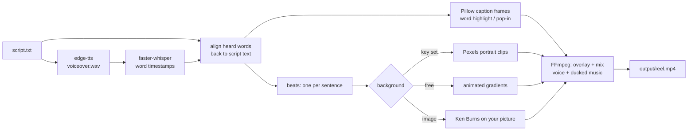

# ReelForge

Give it a script, get back a finished vertical (1080x1920) MP4 with a neural voiceover, word-synced animated captions, background visuals that change with the script, and optional ducked music. Everything is free and runs on your machine: no paid APIs.

> **Honest note:** the output is the automated "faceless creator" style: stock clips or gradients, bold captions, a TTS voice. It is clean and consistent, not cinematic, and it does not edit like a human would.



## How it works

1. **Voiceover:** [edge-tts](https://github.com/rany2/edge-tts) speaks the script with a Microsoft neural voice (free, needs internet).
2. **Timing:** [faster-whisper](https://github.com/SYSTRAN/faster-whisper) transcribes that audio locally with word timestamps. The heard words are diffed against the script, so the captions show *your* spelling and punctuation ("$1,000", not "one thousand dollars") with Whisper's timing.
3. **Captions:** words are grouped (3 per caption by default, breaking at punctuation) and drawn with Pillow: white text, thick outline, current word highlighted, and a short pop-in when each phrase appears. All frames play as one transparent overlay stream.
4. **Visuals:** the script is cut into beats (one per sentence, at most 6 s each). Each beat gets a Pexels portrait clip searched with keywords from that sentence, or an animated gradient, or a slow zoom on your image. Clips are scaled to cover 9:16 and centre-cropped.
5. **Assembly:** FFmpeg overlays the captions, mixes the voice with music that dips while the voice speaks (sidechain compression), and writes H.264/AAC MP4 to `output/`.

## Install

Needs Python 3.11+ and FFmpeg.

```bash
cd reelforge
python -m venv .venv
.venv\Scripts\activate            # macOS/Linux: source .venv/bin/activate
pip install -r requirements.txt
pip install -e .                  # adds the `reelforge` command
```

FFmpeg: `winget install Gyan.FFmpeg.Essentials` (Windows), `brew install ffmpeg` (macOS) or `sudo apt install ffmpeg` (Linux). ReelForge also finds a winget install that is not on PATH yet.

The first run downloads the Whisper `base.en` model (about 145 MB) into `data/models/`.

## Run

```bash
reelforge make --script samples/script.txt                 # -> output/reel.mp4
reelforge make --script samples/script.txt --bg gradient   # force the free background
reelforge make --script my.txt --bg image --image photo.jpg --out output/photo-reel.mp4
reelforge make --script my.txt --topic "deep sea" --voice en-GB-RyanNeural
reelforge selftest                                         # full pipeline check, no keys needed
reelforge ui                                               # local web app at http://127.0.0.1:8770
```

Each run logs the four stages (`voiceover -> captions -> visuals -> assemble`).

**Web app:** `reelforge ui` opens a dark page on `127.0.0.1` where you paste a script, pick voice, background and caption style, press **Make reel**, and watch the result in a phone-shaped player. It only listens on your own machine.

## Add a Pexels key (optional)

1. Get a free key at <https://www.pexels.com/api/>.
2. `copy .env.example .env` (or `cp`) and set `PEXELS_API_KEY=...`.

With a key, `mode = "pexels"` (the default) searches portrait clips per sentence, falls back to the topic, and caches downloads in `data/cache/`. Without a key, or if a search finds nothing, that beat uses a gradient instead, so the tool always works for free. The key is only read from `.env` and never printed.

## Add music (optional)

Drop a royalty-free `.mp3` into `assets/music/`. The first one (alphabetically) is looped under the voice, ducked while the voice speaks, and faded out at the end. Pass `--music path.mp3` to choose one. With no file, the reel has voice only. Music files are git-ignored.

## Config

Everything lives in [`config.toml`](config.toml): voice and speed, Whisper model, resolution/fps, background mode, beat length, footage darkening, caption style (`highlight` or `pop`), words per caption, font, size, colours, outline, vertical position, uppercase, music volume and ducking.

List voices with `edge-tts --list-voices`.

## Self-test

`reelforge selftest` makes a short reel from a built-in script with gradient backgrounds and a generated tone as the music bed. It then checks each stage: voice audio exists, caption words are matched and timed in order, background rendered, final file is 1080x1920 with audio and the right length, and the whole file decodes with no errors.

Real run on Windows 11, Ryzen 5 5600H, CPU only (ffmpeg path shortened):

```
ReelForge selftest  (gradient background, synthetic music bed, no API keys)

   [1/4] voiceover   edge-tts en-US-AndrewMultilingualNeural
         9.2s of speech
   [2/4] captions   faster-whisper base.en word timing
         29/29 script words matched to speech, 11 caption phrases
   [3/4] visuals    mode=gradient
       beat 1/3  3.2s  gradient
       beat 2/3  4.7s  gradient
       beat 3/3  1.9s  gradient
   [4/4] assemble   1080x1920 @ 30fps, music: selftest_music.mp3 (ducked)
         done -> ...\reelforge\output\selftest.mp4  (46.8s)

  PASS  ffmpeg found               ...\ffmpeg-9.0.1-essentials_build\bin\ffmpeg.exe
  PASS  voiceover generated        9.22s wav
  PASS  captions timed             29/29 words matched, first word at 0.00s, last ends 8.80s of 9.22s
  PASS  caption frames drawn       11 phrases
  PASS  visuals rendered           3 gradient beats
  PASS  video rendered             1080x1920, 9.83s, audio=yes
  PASS  file plays (full decode)   2099 KB, no decode errors

7/7 checks passed
```

`pytest` covers word alignment, caption grouping and timing, beat splitting, keywords and caption image rendering.

## Limitations

- **Not cinematic.** Hard cuts between beats, no B-roll matching beyond keyword search, no transitions or sound effects.
- **Stock matching is keyword-based.** Keywords are the longest non-common words in each sentence, so abstract sentences can get loosely related clips.
- **Cropping is a centre crop.** Pexels search asks for portrait clips so little gets cut, but a landscape clip's subject can still end up off-centre. There is no subject tracking.
- **Voiceover needs internet** (edge-tts uses Microsoft's free online service). Whisper, rendering and the gradient/image modes are fully local.
- **Caption timing depends on Whisper.** On clean TTS audio it is tight, but words Whisper misses get interpolated timings.
- English-tuned by default (`base.en`); set `whisper_model = "base"` and a matching voice for other languages.
- Rendering is CPU-only H.264 (`libx264`). On a Ryzen 5 5600H laptop, `samples/script.txt` (27 s of speech) took about 75 s end to end.
- The Pexels path has been tested only for its fallback (a bad key switches to gradients); it has not been run with a real key yet.
- Ducking has been tested with a generated tone (selftest), not judged by ear on real music tracks.
- Very long sentences are split every 6 s, which can leave a short (about 1 s) final beat.

## License

MIT
