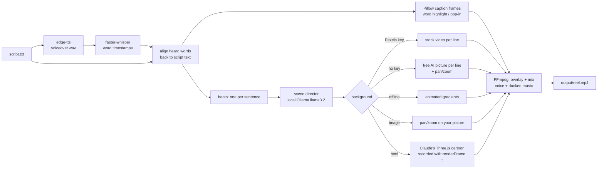

# ReelForge

Give it a script, get back a finished vertical (1080x1920) MP4 with a neural voiceover, word-synced animated captions, background visuals that change with the script, and optional ducked music. Everything is free and runs on your machine: no paid APIs.

**New: 3D cartoon reels by Claude.** The trending style where Claude writes a moving, toon-shaded 3D cartoon (Three.js) for your story. ReelForge gives you the prompt, records Claude's animation frame by frame in sync with the voiceover, and adds captions and music. A ready-made demo is included (`samples/robot-moon.html`).

> **Honest note:** the output is the automated "faceless creator" style: stock clips or AI stills with slow pan/zoom, bold captions, a TTS voice. It is clean and consistent, not cinematic, and it does not edit like a human would.



## How it works

1. **Voiceover:** [edge-tts](https://github.com/rany2/edge-tts) speaks the script with a Microsoft neural voice (free, needs internet).
2. **Timing:** [faster-whisper](https://github.com/SYSTRAN/faster-whisper) transcribes that audio locally with word timestamps. The heard words are diffed against the script, so the captions show *your* spelling and punctuation ("$1,000", not "one thousand dollars") with Whisper's timing.
3. **Captions:** words are grouped (3 per caption by default, breaking at punctuation) and drawn with Pillow: white text, thick outline, current word highlighted, and a short pop-in when each phrase appears. All frames play as one transparent overlay stream.
4. **Scene director:** the script is cut into beats (one per sentence, at most 6 s each). A local [Ollama](https://ollama.com) model (`llama3.2:3b`) reads the whole script and, for each line, writes a short stock-video search and a one-sentence picture description of what the viewer should see ("pressure like fifty jumbo jets" becomes `jumbo jets stacked`). If Ollama is not running, it falls back to keywords from the line.
5. **Visuals** (`mode` in config, `--bg` on the CLI):
   - `auto` (default): `pexels` if a key is set, otherwise `ai`.
   - `pexels`: a portrait stock **video** per line from Pexels (free key). If no clip matches, that line gets an AI picture instead.
   - `ai`: a free AI-generated picture per line from [Pollinations](https://pollinations.ai) (no key), animated with a slow zoom or pan. `art_style = "cartoon"` (default) makes cute 3D Pixar-style scenes. The director first fixes one main character (the script's own, like "a tiny robot", or an invented guide) and describes it the same way in every scene, so the pictures read as one story. `art_style = "photo"` makes realistic shots.
   - `gradient`: animated colour gradients, fully offline and fastest.
   - `image`: slow zoom on your own picture.

   Everything is scaled to cover 9:16 and centre-cropped. Downloads are cached in `data/cache/`.
6. **Assembly:** FFmpeg overlays the captions, mixes the voice with music that dips while the voice speaks (sidechain compression), and writes H.264/AAC MP4 to `output/`.

## Install

Needs Python 3.11+ and FFmpeg.

```bash
cd reelforge
python -m venv .venv
.venv\Scripts\activate            # macOS/Linux: source .venv/bin/activate
pip install -r requirements.txt
pip install -e .                  # adds the `reelforge` command
# 3D cartoon mode records with your installed Edge or Chrome. If you have neither:
# playwright install chromium   (about 150 MB)
```

FFmpeg: `winget install Gyan.FFmpeg.Essentials` (Windows), `brew install ffmpeg` (macOS) or `sudo apt install ffmpeg` (Linux). ReelForge also finds a winget install that is not on PATH yet.

The first run downloads the Whisper `base.en` model (about 145 MB) into `data/models/`.

## Run

```bash
reelforge make --script samples/script.txt                 # -> output/reel.mp4
reelforge make --script samples/script.txt --bg gradient   # force the free background
reelforge make --script my.txt --bg image --image photo.jpg --out output/photo-reel.mp4
reelforge make --script my.txt --topic "deep sea" --voice en-GB-RyanNeural
reelforge make --script samples/robot-moon.txt --html samples/robot-moon.html   # 3D cartoon demo
reelforge prompt --script my.txt                           # Claude prompt for a 3D cartoon
reelforge selftest                                         # full pipeline check, no keys needed
reelforge ui                                               # local web app at http://127.0.0.1:8770
```

Each run logs the four stages (`voiceover -> captions -> visuals -> assemble`).

**Web app:** `reelforge ui` opens a dark page on `127.0.0.1` where you paste a script, pick voice, background and caption style, press **Make reel**, and watch the result in a phone-shaped player. It only listens on your own machine.

## 3D cartoon reels by Claude

This mode makes real animation: characters that move, walk, wave and react, rendered as 3D cartoon (toon shading) from code.

**Direct (one click):** if [Claude Code](https://claude.com/claude-code) is installed and logged in, leave the HTML out and ReelForge runs `claude -p` with the prompt in an empty temp folder, saves Claude's animation next to the video (`output/<name>.html`) and renders it. It uses your own Claude plan; no API key. Writing the animation took about 8 minutes for the 26-second `samples/rag.txt` reel.

```bash
reelforge make --script samples/rag.txt --topic "RAG explained" --bg html
```

In the web app: choose **3D cartoon animation by Claude**, leave the HTML box empty and press **Make reel**.

**Manual (claude.ai):**

1. Write your script (one sentence = one scene).
2. Get the prompt: `reelforge prompt --script my.txt --topic "space"`, or press **Copy Claude prompt** in the web app.
3. Paste it into Claude (claude.ai or Claude Code) and save its reply as `my-animation.html`. You can open that file in a browser to preview it.
4. Make the reel:

```bash
reelforge make --script my.txt --html my-animation.html
```

Or paste the HTML into the web app and press **Make reel**.

**How the sync works:** the prompt asks Claude for one HTML file that defines `window.renderFrame(t)`, a function that draws the exact picture for second `t`. ReelForge measures the voiceover, tells the page when each sentence starts and ends (`window.REEL.scenes`), then opens it in your installed Edge or Chrome (headless, GPU), calls `renderFrame` for every frame at 30 fps, and pipes the screenshots into FFmpeg. Recording is frame-exact, so a slow PC makes recording slower, not choppier.

**Try the demo:** `reelforge make --script samples/robot-moon.txt --html samples/robot-moon.html` (the web app's **Load demo** button does the same). It is an 11-second story: a tiny robot wakes up on the Moon, looks at Earth, builds a rocket from flying junk and flies home. On a Ryzen 5 5600H laptop with integrated graphics it took about 70 s end to end, about 0.16 s per 1080x1920 frame.

## Add a Pexels key (optional)

1. Get a free key at <https://www.pexels.com/api/>.
2. `copy .env.example .env` (or `cp`) and set `PEXELS_API_KEY=...`.

This gives the best result: real moving footage for each line. With a key, `auto` mode searches a portrait clip per line, using the scene director's query first, then a keyword, then the topic. Without a key, `auto` uses free AI pictures, so the tool still works with zero keys. The key is only read from `.env` and never printed.

## Scene director (optional)

Install [Ollama](https://ollama.com) and run `ollama pull llama3.2:3b` (about 2 GB). ReelForge uses it automatically when it is running. Set `director_model = ""` in `config.toml` to switch it off and use plain keywords.

## Add music (optional)

Drop a royalty-free `.mp3` into `assets/music/`. The first one (alphabetically) is looped under the voice, ducked while the voice speaks, and faded out at the end. Pass `--music path.mp3` to choose one. With no file, the reel has voice only. Music files are git-ignored.

## Config

Everything lives in [`config.toml`](config.toml): voice and speed, Whisper model, resolution/fps, background mode, scene-director model, AI fallback and pacing, beat length, footage darkening, caption style (`highlight` or `pop`), words per caption, font, size, colours, outline, vertical position, uppercase, music volume and ducking.

List voices with `edge-tts --list-voices`.

## Self-test

`reelforge selftest` makes a short reel from a built-in script with gradient backgrounds and a generated tone as the music bed. It then checks each stage: voice audio exists, caption words are matched and timed in order, background rendered, final file is 1080x1920 with audio and the right length, and the whole file decodes with no errors.

Real run on Windows 11, Ryzen 5 5600H, CPU only (ffmpeg path shortened):

```
ReelForge selftest  (gradient background, synthetic music bed, no API keys)

   [1/4] voiceover   edge-tts en-US-AndrewMultilingualNeural
         9.2s of speech
   [2/4] captions   faster-whisper base.en word timing
         29/29 script words matched to speech, 11 caption phrases
   [3/4] visuals    mode=gradient
       beat 1/3  3.2s  gradient
       beat 2/3  4.7s  gradient
       beat 3/3  1.9s  gradient
   [4/4] assemble   1080x1920 @ 30fps, music: selftest_music.mp3 (ducked)
         done -> ...\reelforge\output\selftest.mp4  (46.8s)

  PASS  ffmpeg found               ...\ffmpeg-9.0.1-essentials_build\bin\ffmpeg.exe
  PASS  voiceover generated        9.22s wav
  PASS  captions timed             29/29 words matched, first word at 0.00s, last ends 8.80s of 9.22s
  PASS  caption frames drawn       11 phrases
  PASS  visuals rendered           3 gradient beats
  PASS  video rendered             1080x1920, 9.83s, audio=yes
  PASS  file plays (full decode)   2099 KB, no decode errors

7/7 checks passed
```

`pytest` covers word alignment, caption grouping and timing, beat splitting, keywords and caption image rendering.

## Limitations

- **Animation quality depends on the HTML.** The 3D cartoon mode is only as good as the animation Claude writes. Simple primitive-built characters, no lip-sync. If Claude breaks the `renderFrame` rule, ReelForge stops with a clear error, and you ask Claude to fix it. The included demo was hand-written to the same rules; Claude Code's reply to the generated prompt has been rendered end to end (`samples/rag.txt`); framing and polish vary from run to run.
- **Not cinematic.** Hard cuts between beats, no transitions or sound effects. AI-picture mode gives moving *stills* (pan/zoom), not real motion. Only the 3D cartoon mode and Pexels mode have real movement.
- **Character consistency is approximate.** The same text description is reused in every scene, but the free image model still draws the character a bit differently each time.
- **Scene matching is as good as a 3B local model.** It usually picks what the line mentions, but abstract lines ("scientists have found life") can get a loosely related scene. Without Ollama it uses plain keywords, which is weaker.
- **Free AI pictures are slow and watermarked.** Pollinations' free tier allows about one image per 45 s per IP and returns 576x1024 images (upscaled, so slightly soft) with a small `pollinations.ai` mark in the corner, which ReelForge leaves in place.
- **Cropping is a centre crop.** Pexels search asks for portrait clips so little gets cut, but a landscape clip's subject can still end up off-centre. There is no subject tracking.
- **Voiceover needs internet** (edge-tts uses Microsoft's free online service). Whisper, rendering and the gradient/image modes are fully local.
- **Caption timing depends on Whisper.** On clean TTS audio it is tight, but words Whisper misses get interpolated timings.
- English-tuned by default (`base.en`); set `whisper_model = "base"` and a matching voice for other languages.
- Rendering is CPU-only H.264 (`libx264`). On a Ryzen 5 5600H laptop, `samples/script.txt` (27 s of speech) took about 75 s end to end.
- The Pexels path has been tested only for its fallback (a bad key switches to other visuals); it has not been run with a real key yet.
- Ducking has been tested with a generated tone (selftest), not judged by ear on real music tracks.
- Very long sentences are split every 6 s, which can leave a short (about 1 s) final beat.

## License

MIT
