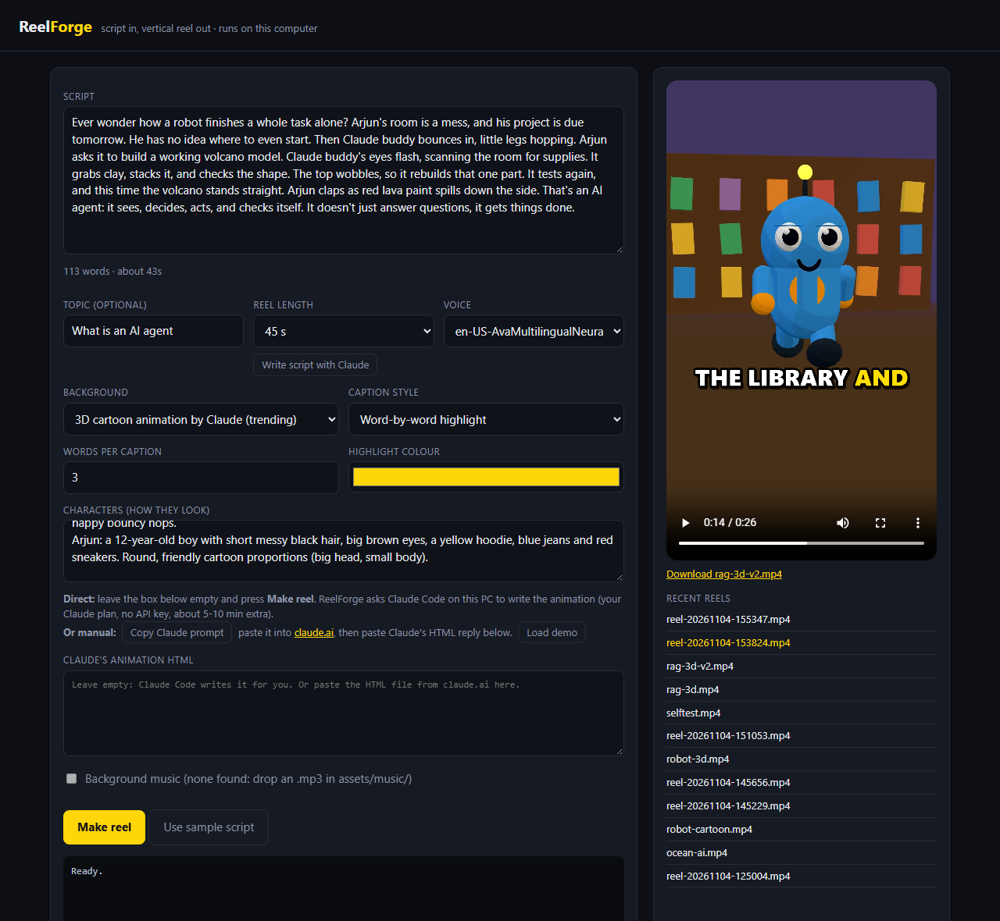
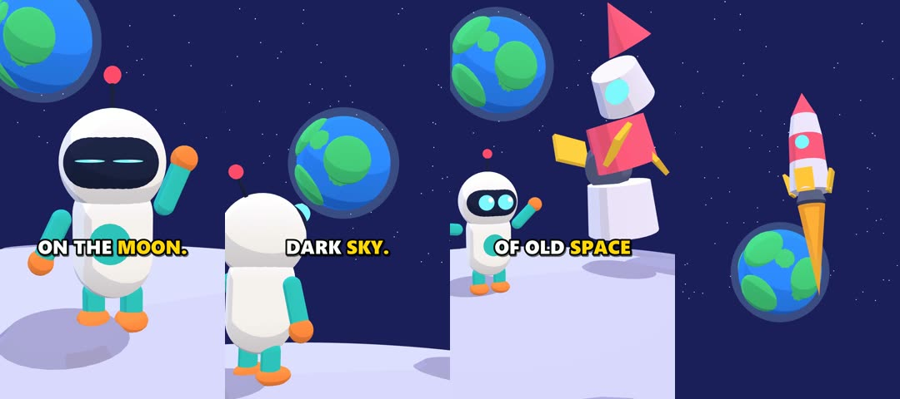
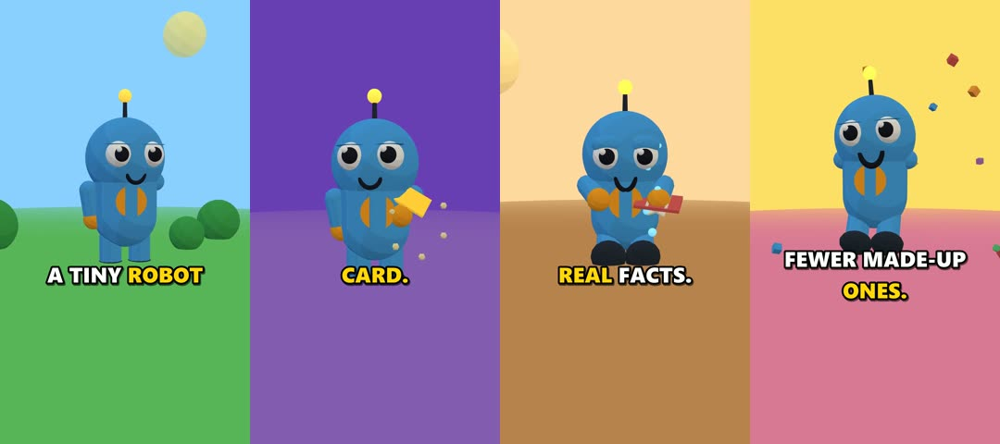
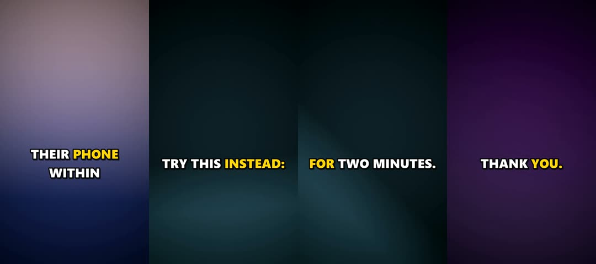
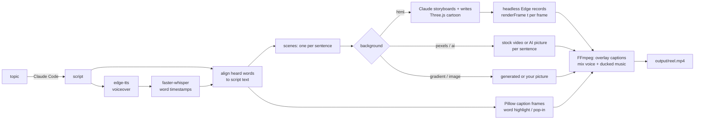

# ReelForge

Turn a topic or a script into a finished vertical reel (1080x1920 MP4, 90 seconds max): a neural voiceover, word-synced animated captions, visuals that change with every sentence, and optional ducked music.

Its main mode makes **3D cartoon reels written by Claude**, the trending style where Claude writes the animation as code (Three.js). ReelForge writes the prompt, has Claude storyboard and build each scene, records the animation frame by frame in sync with the voice, and adds the captions. Other modes use stock video, AI pictures, gradients or your own image.

Everything runs on your computer. There are no paid APIs and no API keys in the code.

**Demo site with the reels and live 3D scenes: https://omkar210404.github.io/Reel-Forge/**



**Real frames from reels made with ReelForge** (captions burned in):

| 3D cartoon, hand-written demo (`samples/robot-moon.html`) |
|---|
|  |
| **3D cartoon written by Claude Code** (`samples/rag.txt`, "RAG explained") |
|  |
| **Gradient mode** (offline, used by the self-test) |
|  |

> **Honest note:** this is the automated "faceless creator" style. The 3D characters are built from simple shapes and do not lip-sync, and each Claude-written animation is different: some come out better than others. It is fun and consistent, not Pixar.

## Quick start

Needs Python 3.11+, FFmpeg, and Edge or Chrome (already on most PCs).

```bash
cd reelforge
python -m venv .venv
.venv\Scripts\activate            # macOS/Linux: source .venv/bin/activate
pip install -r requirements.txt
pip install -e .                  # adds the `reelforge` command
reelforge selftest                # checks every stage, no keys needed
reelforge ui                      # opens http://127.0.0.1:8770
```

- FFmpeg: `winget install Gyan.FFmpeg.Essentials` (Windows), `brew install ffmpeg` (macOS) or `sudo apt install ffmpeg` (Linux). ReelForge also finds a winget install that is not on PATH yet.
- The first run downloads the Whisper `base.en` model (about 145 MB) into `data/models/`.
- No Edge or Chrome? Run `playwright install chromium` (about 150 MB).

## Connect Claude (for scripts and 3D cartoons)

ReelForge talks to Claude through **Claude Code**, the command-line app, using your own Claude plan. It does not use an API key, and it never sees or stores your Claude login.

1. Install Node.js 18+ from <https://nodejs.org>.
2. Install Claude Code: `npm install -g @anthropic-ai/claude-code`
3. Log in once: run `claude` in a terminal, follow the login steps, then type `/exit`.
4. Check it works: `claude -p "reply with: ready"` should print `ready`.

That's it. ReelForge finds the `claude` command by itself and runs it in an empty temporary folder, so Claude only sees the prompt, not your files.

**No Claude Code?** Use claude.ai instead: press **Copy Claude prompt** in the web app (or run `reelforge prompt --script my.txt`), paste it into <https://claude.ai>, and paste the HTML file Claude replies with back into ReelForge.

**Usage limits:** each 3D animation is one long Claude reply, and a script is one short one. If your plan's session limit is reached, ReelForge shows Claude's message (for example "resets 5pm"). Wait, or use another mode.

## Make a 3D cartoon reel

In the web app:

1. Type a **Topic**, pick a **Reel length** (30-90 s) and a style, either **Mini movie (characters talk)** or **Narration only**, and press **Write script with Claude**. Or paste your own script; the word counter shows the length.
2. Choose Background: **3D cartoon animation by Claude**.
3. Describe your **Characters** (optional but recommended), for example:
   ```
   Arjun: a 12-year-old boy with short messy black hair, a yellow hoodie, blue jeans and red sneakers.
   Buddy: a tiny cute creature made of rounded orange blocks, two small black square eyes, four stubby legs.
   ```
4. Leave the HTML box empty and press **Make reel**. Claude storyboards and builds the animation (usually 5-12 minutes), then ReelForge records it (about 2 minutes for 30 s). The video and Claude's HTML are saved in `output/`.

### Mini movies: characters that talk

Write the script as dialogue, one line per line, each starting with the speaker's name:

```
NARRATOR: Arjun stared at a giant mountain of homework and chores.
ARJUN: I'll never finish all of this alone!
CLAUDE: Hop hop, don't worry, let me help you!
```

ReelForge then:

- **Gives each speaker their own voice.** NARRATOR uses the main voice. Mascot-like names (CLAUDE, BUDDY, ROBOT...) get the cute child voice `en-US-AnaNeural`, and people get the other voices. edge-tts has no boy voice, so the first human gets `en-IN-PrabhatNeural` pitched up 20 Hz. Choose your own with **Voice per speaker**, e.g. `CLAUDE=en-US-AnaNeural, ARJUN=en-US-GuyNeural+15Hz`.
- **Colours the captions per speaker**, and never mixes two speakers in one caption.
- **Makes each line its own scene,** and tells the animation who says which word (`window.REEL.words`), so the speaking character's mouth moves while their words play and the others react.

`samples/agent-movie.txt` is a mini movie written by Claude Code (`reelforge script --dialogue`).

Same thing on the command line:

```bash
reelforge script --topic "What is an AI agent" --seconds 45 --dialogue > my.txt
reelforge script --topic "What is an AI agent" --seconds 45 > my.txt          # narration only
reelforge make --script my.txt --topic "What is an AI agent" --characters "Arjun: ..." --bg html
reelforge make --script samples/robot-moon.txt --html samples/robot-moon.html   # ready-made demo, no Claude needed
```

**What Claude is asked to do** (see `claude_prompt` in [reelforge/animate.py](reelforge/animate.py)):

- **Storyboard first:** for every sentence, write down the location, props, what each character does, the emotion, the shot and the camera move, with no repeated shot back to back.
- **Full sets:** a foreground, the characters, and a detailed background with 8+ props and its own lighting mood.
- **Clear props:** every object the narration mentions is modelled and recognisable (a laptop has keys and a glowing screen; a test result is a red or green light).
- **Acting and staging:** characters handle props and show emotion, faces are never blocked, and framing fits the narrow 9:16 frame and the caption band.

**How the sync works:** the animation defines `window.renderFrame(t)`, which draws the exact picture for second `t`. ReelForge measures the voiceover, tells the page when each sentence starts and ends (`window.REEL.scenes`), opens it in headless Edge or Chrome (GPU), calls `renderFrame` for every frame at 30 fps and pipes the screenshots into FFmpeg. Recording is frame-exact, so a slow PC records slower, not choppier.

## Other background modes

| Mode (`--bg`) | What you get | Needs |
|---|---|---|
| `html` | 3D cartoon animation written by Claude | Claude Code or claude.ai |
| `pexels` | real portrait stock video per sentence | free Pexels key |
| `ai` | free AI picture per sentence with slow pan/zoom (cartoon or photo style) | internet; about 45 s per picture |
| `auto` (default) | `pexels` if a key is set, otherwise `ai` | |
| `gradient` | animated colour gradients | nothing, fully offline |
| `image` | slow pan/zoom on your own picture | `--image photo.jpg` |

For `pexels` and `ai`, a local [Ollama](https://ollama.com) model (`llama3.2:3b`, about 2 GB, optional) reads the script and decides what each sentence should show. Without Ollama it uses keywords.

**Pexels key (optional):** get a free key at <https://www.pexels.com/api/>, then `copy .env.example .env` and set `PEXELS_API_KEY=...`.

**Music (optional):** drop a royalty-free `.mp3` into `assets/music/`. It loops under the voice, dips while the voice speaks, and fades out at the end.

## Reel rules

- **90 seconds max.** Scripts over about 234 words are refused before any work starts, and a voiceover longer than 90 s stops the run. Change `max_seconds` in `config.toml` if you need to.
- **One sentence = one scene.** Shorter sentences mean faster cuts.
- **Output:** 1080x1920, 30 fps, H.264 + AAC, ready for Reels, Shorts and TikTok.

## Keys and privacy

- **Keys live only in `.env`**, which is git-ignored. `.env.example` has empty values. The Pexels key is never printed or logged.
- **Your Claude login stays with Claude Code** (in your user folder, outside this project). ReelForge only runs the `claude` command; it never reads tokens.
- **Git-ignored:** `.env`, `.claude/`, `.venv/`, `data/` (models, caches, temp files), `output/` (videos and Claude's HTML) and `assets/music/*`.
- **The web app listens on 127.0.0.1 only**, so other devices cannot reach it.
- **Network use:** voiceover (Microsoft edge-tts), Three.js from the jsDelivr CDN while recording, and only when you choose them, Pexels, Pollinations and Claude.

## How it works



1. **Voiceover:** [edge-tts](https://github.com/rany2/edge-tts) speaks the script with a Microsoft neural voice (free, needs internet; retried automatically if the service drops a request).
2. **Timing:** [faster-whisper](https://github.com/SYSTRAN/faster-whisper) transcribes the voice locally with word timestamps. Those words are matched back to the script, so captions keep your spelling ("$1,000", not "one thousand dollars") with Whisper's timing.
3. **Captions:** 3 words per caption by default (breaking at punctuation), drawn with Pillow: white text, thick outline, the current word highlighted, and a short pop-in for each phrase.
4. **Visuals:** one scene per sentence, from the chosen background mode.
5. **Assembly:** FFmpeg overlays the captions, mixes the voice with music that dips under speech (sidechain compression), and writes the MP4 to `output/`.

All settings (voice, speed, resolution, max length, background mode, caption font, size, colours and position, music level) are in [`config.toml`](config.toml). List voices with `edge-tts --list-voices`.

## Self-test

`reelforge selftest` makes a short reel from a built-in script (gradient background, a generated tone as music) and checks each stage. Real run on Windows 11, Ryzen 5 5600H, CPU only (paths shortened):

```
  PASS  ffmpeg found               ...\ffmpeg-9.0.1-essentials_build\bin\ffmpeg.exe
  PASS  voiceover generated        9.22s wav
  PASS  captions timed             29/29 words matched, first word at 0.00s, last ends 8.80s of 9.22s
  PASS  caption frames drawn       11 phrases
  PASS  visuals rendered           3 gradient beats
  PASS  video rendered             1080x1920, 9.83s, audio=yes
  PASS  file plays (full decode)   2087 KB, no decode errors

7/7 checks passed
```

`pytest` (9 tests) covers word alignment, caption grouping and timing, scene splitting, keywords, caption rendering, the Claude prompt, dialogue parsing and voice casting, and the check that catches a prompt pasted where the HTML should go.

## Measured times (Ryzen 5 5600H laptop, integrated graphics)

| Reel | Time |
|---|---|
| 11 s robot demo (ready-made HTML) | about 70 s |
| 26 s "RAG explained", Claude Code writes the animation | about 9-11 min (mostly Claude writing) |
| 41 s "What is an AI agent" (narration), Claude Code writes the animation | about 16 min |
| 45 s script written by Claude Code | about 45-55 s |
| 12-second 3-voice dialogue reel (gradient) | about 45 s |
| 27 s gradient reel | about 75 s |

## Limitations

- **3D quality varies run to run.** It depends on the animation Claude writes. Characters are built from primitives and do not lip-sync. If an animation breaks the `renderFrame` rule, ReelForge stops with a clear error; press Make reel again for a new version.
- **Claude Code uses your plan's limits.** A 3D reel is one long Claude reply.
- **Mini movies are new.** Dialogue voices, per-speaker captions and scene timing are tested (with a gradient background), and Claude Code wrote `samples/agent-movie.txt`. Whether each character's mouth moves on their words depends on the animation Claude writes.
- **Long scripts take longer.** Claude Code gets up to 40 minutes per animation. If it runs over, ReelForge stops it cleanly and says so; press Make reel again.
- **AI pictures** (Pollinations free tier) are slow (about one per 45 s), 576x1024 (slightly soft), and carry a small `pollinations.ai` mark that ReelForge leaves in place.
- **Pexels mode** has only been tested for its fallback (a bad key switches to other visuals), not with a real key.
- **Ducking** has been tested with a generated tone, not judged by ear on real music.
- **Voiceover and Three.js loading need internet.** Whisper, captions and rendering are local.
- English-tuned by default (`base.en`); set `whisper_model = "base"` and a matching voice for other languages.

## License

MIT
